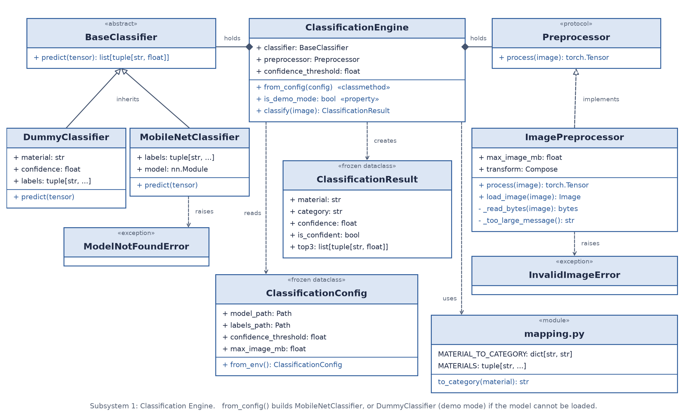
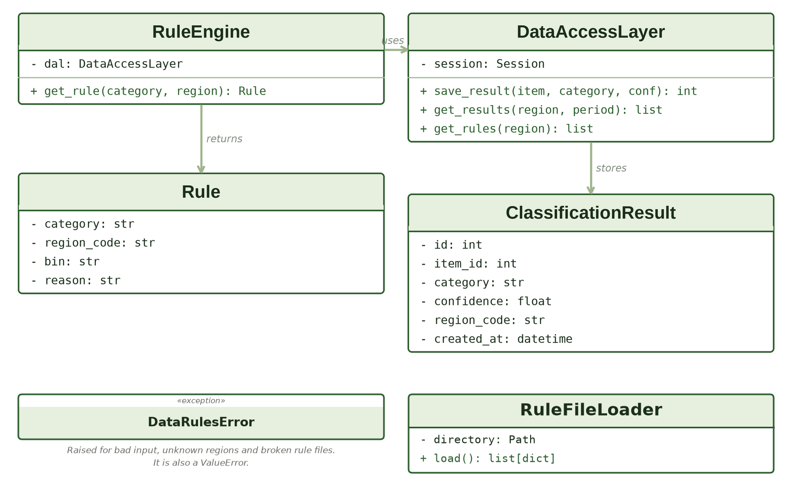
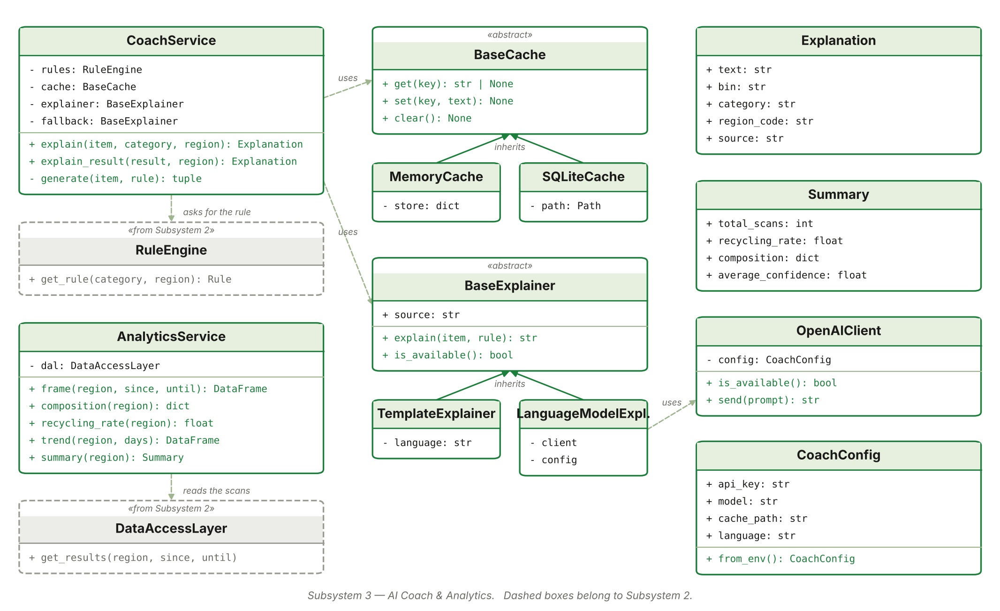
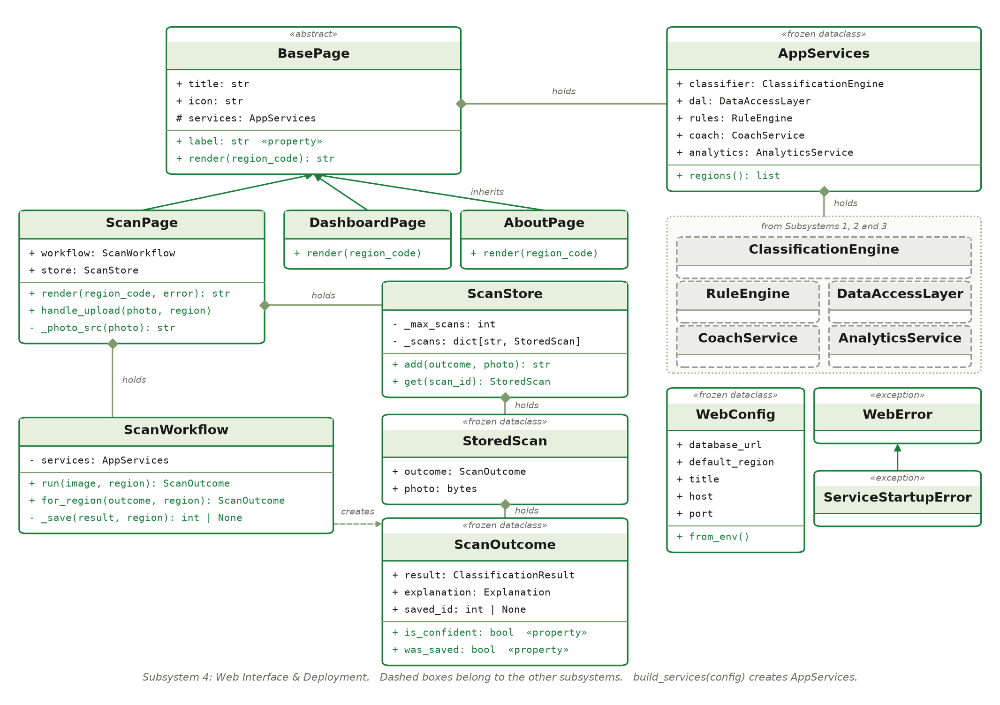

# AI-Powered Waste Sorting & Recycling Assistant

Capstone project of the *Compact Programming Course with Python*,
University of Applied Sciences and Arts Dortmund, winter 2026.

A resident of Dortmund photographs one household waste item. The app:

1. recognises the material with a trained MobileNetV2,
2. maps it to a category: recyclable, compostable or landfill,
3. looks up the Dortmund rule and the right bin,
4. explains why in a short text, with OpenAI or an offline template,
5. saves the scan, and a municipality dashboard shows the statistics.

If the model is not confident, the app asks for a new photo instead of guessing.

## Team

| # | Subsystem | Folder | Owner | Details |
|---|---|---|---|---|
| 1 | Classification Engine (computer vision) | `classification/` | Romina Hajizadeh | [README](classification/README.md) |
| 2 | Data & Rules (SQLite, SQLAlchemy) | `data_rules/` | Fatemeh Hemmati | [README](data_rules/README.md) |
| 3 | AI Coach & Analytics (OpenAI, Plotly dashboard) | `coach/` | Sana Mohammadi | [README](coach/README.md) |
| 4 | Web Interface & Deployment (Flask, Docker) | `web/` | Amirreza Seighali | [README](web/README.md) |

## Run the app

### With Docker (recommended)

Only Docker is needed. From this folder:

```bash
docker compose up --build
```

Open http://localhost:8501. Stop it with `Ctrl+C`, then `docker compose down`.
Scans are kept in a Docker volume, so they survive a restart.

### Without Docker

Python 3.12 or newer. From this folder, on Windows:

```bash
python -m venv .venv
.venv\Scripts\activate
pip install torch==2.15.0 torchvision==0.29.2 --index-url https://download.pytorch.org/whl/cpu
pip install -r web/requirements.txt
python web/src/web/app.py
```

Open http://localhost:8501. On macOS or Linux, activate with `source .venv/bin/activate` instead.

### AI explanations (optional)

Copy `.env.example` to `.env` and put your OpenAI key in it. Both ways of running the app
read this file. Without a key the app still works and answers from offline templates.
`.env` is never committed.

## Tests

```bash
python run_tests.py
```

This runs the suites of all four subsystems, without network, API key or database file.
To run one suite, go to its folder and run `python -m pytest`.

## How the subsystems work together

```text
photo --> [4 Web] --> [1 Classification] --> material, category, confidence
             |
             +------> [3 Coach] --> [2 Data & Rules: rule and bin] --> explanation
             |
             +------> [2 Data & Rules: save the scan]
             |
             +------> [3 Analytics] --> [2 Data & Rules: read scans] --> dashboard
```

Each subsystem keeps its own `src/<package>/`, `tests/`, `pytest.ini` and `README.md`.
The agreed interfaces are:

```python
from classification import ClassificationEngine
from data_rules import create_services
from coach import create_coach_services

engine = ClassificationEngine.from_config()
result = engine.classify(photo_bytes)        # material, category, confidence, is_confident, top3

dal, rules = create_services()
rule = rules.get_rule(result.category, "DO")  # category, region_code, bin, reason
dal.save_result(result.material, result.category, result.confidence, "DO")

coach, analytics = create_coach_services(dal, rules)
answer = coach.explain_result(result, "DO")  # text, bin, category, source
summary = analytics.summary("DO")
```

Only `data_rules` talks to the project database, and only `coach` calls the OpenAI API.

## Class diagrams

### Subsystem 1: Classification Engine



### Subsystem 2: Data & Rules



Database design: [entity relationship diagram](data_rules/docs/erd.png).

### Subsystem 3: AI Coach & Analytics



### Subsystem 4: Web Interface & Deployment



## Results of the model

Accuracy on 484 test photos the model never saw in training: **0.897**.
With the confidence threshold of 0.6, the app answers 92.8 % of those photos, and
92 % of those answers are correct. Real photos are usually harder than this test set;
see the [known limits](classification/README.md#known-limits).

## Known limits

- One item per photo works best, and cluttered backgrounds can lower the accuracy.
- Only Dortmund is seeded. A new city is one more JSON file in `data_rules`, with no code change.
- In Dortmund "recyclable" has three destinations (yellow bin, blue paper bin, glass container),
  so the app lists all three instead of one exact bin.
