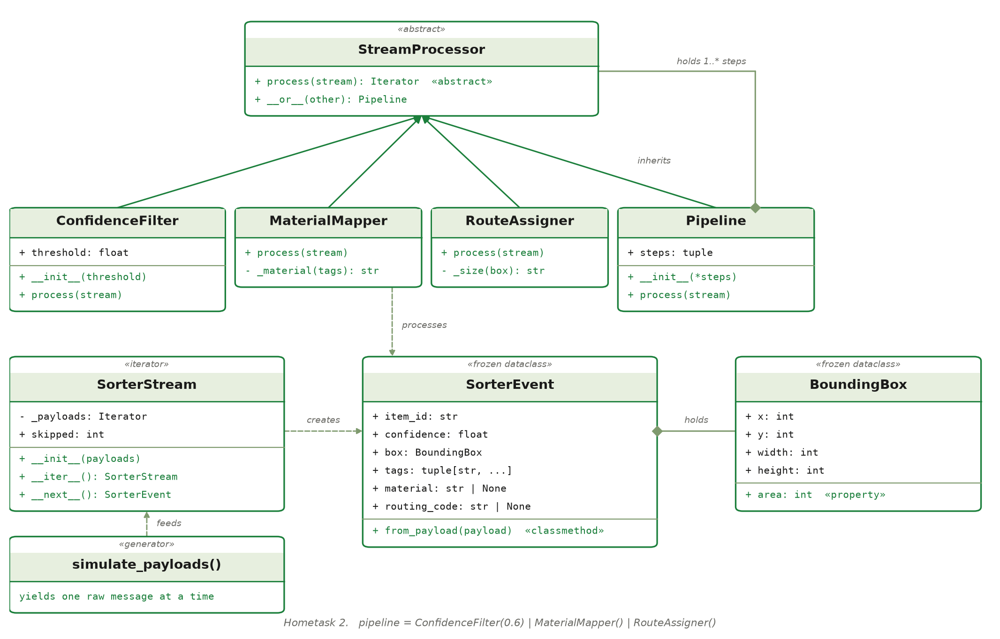

# Hometask 2: Real-Time Data Processing

An event-driven stream processing framework for an automated conveyor belt optical sorter.
It only needs Python itself, and it is separate from the capstone app.

**Video presentation (5 min):** *link to be added*

The sorter sends one message per detected item. The pipeline:

1. filters out low-confidence predictions,
2. turns the visual tags into a material (PET, HDPE, Aluminum, or Other),
3. turns the material and the bounding box size into a conveyor routing code.

```text
raw messages --> SorterStream --> ConfidenceFilter | MaterialMapper | RouteAssigner --> routed items
```

## Run it

From the repository root:

```bash
python stream_processing/demo.py
```

There is no real sorter, so `simulate_payloads()` creates the messages, one at a time.

```bash
cd stream_processing
python -m pytest
```

## Class diagram



## Where each concept is

| Concept | Where |
|---|---|
| Abstract base class | `StreamProcessor` in `processors.py`, with `@abstractmethod process` |
| Inheritance and polymorphism | `ConfidenceFilter`, `MaterialMapper`, `RouteAssigner` and `Pipeline` all inherit from `StreamProcessor` and have the same `process(stream)` |
| Operator overloading | `StreamProcessor.__or__`, so `first \| second` builds a `Pipeline` |
| Iterator | `SorterStream` in `stream.py`, with `__iter__` and `__next__` |
| Generators | `simulate_payloads()` and every `process()` that uses `yield` |

## The rules

| Visual tags | Material | Lane |
|---|---|---|
| bottle + transparent | PET | A1 |
| bottle + opaque | HDPE | A2 |
| can + metallic | Aluminum | B1 |
| anything else | Other | RJ (reject) |

The routing code is the lane and the size of the bounding box: `S` below 5,000 pixels,
`L` from 20,000 pixels, and `M` in between. A large PET bottle gets `A1-L`.

## Files

| File | Content |
|---|---|
| `events.py` | `BoundingBox`, `SorterEvent` |
| `stream.py` | `SorterStream`, `simulate_payloads()` |
| `processors.py` | `StreamProcessor` and its four subclasses |
| `demo.py` | runs the whole pipeline and prints every routed item |
| `tests/` | one or more tests for each concept and each pipeline goal |

## Known limits

The rule tables and the size limits are examples chosen for this exercise, not values from a real sorter.
